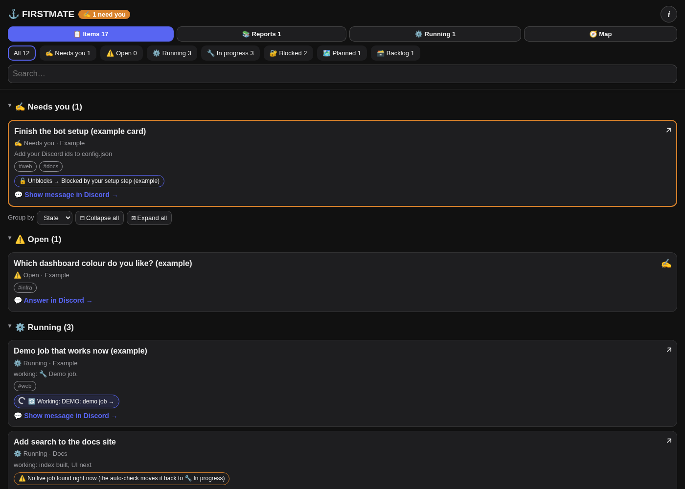

# omp-discord-bot

A Discord bridge for the [OMP](https://github.com/can1357/oh-my-pi) coding agent. One owner writes in a private
Discord server (also from a phone). The bot starts OMP runs, posts the answers, mirrors Herdr agent panes to
channels, talks in a voice channel and keeps live boards of the work.

This is a public copy of a personal setup. It holds no personal values: Discord IDs, host names and paths come
from your config. Some features expect the same companion tools (Herdr, the FIRSTMATE tracker `fm`, Tailscale).
Those features stay off or show nothing when the tools are missing.

- Setup, step by step: [docs/SETUP.md](docs/SETUP.md) (manual steps are marked). One command: `scripts/bootstrap.sh --dry-run`, then without `--dry-run`.
- Full feature list: [docs/FEATURES.md](docs/FEATURES.md). Design decisions and their dates: [docs/UX-DECISIONS.md](docs/UX-DECISIONS.md).
- Internals (sandbox, approval broker, loopback API, voice details): [docs/REFERENCE.md](docs/REFERENCE.md).
- Dashboard and tracker kit: [kit/README.md](kit/README.md). OMP slash commands: [docs/omp-commands.md](docs/omp-commands.md).



The dashboard has its own public repository: [omp-firstmate-dashboard](https://github.com/jeffscottward/omp-firstmate-dashboard).
The screenshot shows only fake sample data.

## Architecture

| Part | What it does | Where |
|---|---|---|
| Bot (this repository) | Discord gateway, OMP runs, Herdr pane mirror, voice, master queue, ask menus, loopback API on `127.0.0.1:47821` | `src/`, `systemd/omp-discord-bot.service` |
| `fm` tracker | Cards in one JSON file (`$FM_DIR/items.json`) plus worker receipts (`$FM_DIR/receipts/`). Agents call `fm set`, `fm field`, `fm beat`, `fm receipt`. Timers (`fm-autoclear`, `fm-prwatch`, `fm-tabwatch`) apply receipts and rules. | `kit/bin/` (Python 3) |
| Dashboard | Reads the same tracker files and shows cards, reports, running jobs and a blocker map. Read-only. | [omp-firstmate-dashboard](https://github.com/jeffscottward/omp-firstmate-dashboard) (TrailBase + Vike), or the static page in `kit/dashboard/web/` |
| Phone access | `tailscale serve` publishes the loopback dashboard and report pages to your tailnet only | §8 in docs/SETUP.md |

Data flow: Discord message → bot → OMP run (or a Herdr pane) → agent updates cards with `fm` → the bot boards and
the dashboard read the tracker files → answers go back to Discord.

## Prerequisites

Every tool and login that the full setup assumes. Optional items only switch off the named feature.

| Need | Version checked | Used for | Required? |
|---|---|---|---|
| Linux with systemd user units (`systemctl --user`, `loginctl enable-linger`) | Omarchy (Arch) | bot, timers, sandbox | yes |
| Bun | 1.4.0 | runs the bot and tests | yes |
| Node.js | 24 or newer | dashboard build, some scripts | for the dashboard |
| Python | 3.11 or newer (3.14 tested), `uv` | `fm` kit, voice servers | yes |
| git, curl, jq, bubblewrap (`bwrap`) | distro packages | basics, run sandbox | yes |
| OMP (`omp` binary) with your own Claude subscription sign-in (`omp` then `/login`) | 18.16.0 | the agent | yes |
| Herdr | 0.9.5 | panes, mirror channels, approval tabs | yes for mirror and approvals |
| tmux | 3.8 | helper TUIs started detached | optional |
| Tailscale (`tailscale serve`) | 1.104 | dashboard and reports on your phone | optional |
| Kokoro TTS server (`systemd/omp-tts.service`) and Whisper (`systemd/omp-whisper.service`) | — | voice answers and voice input | optional |
| ffmpeg | 9.0 | voice audio | for voice |
| Google Chrome or Chromium (headless) | any current | table and chart images (`OMP_TABLES_CHROME`) | optional |
| Graphviz (`dot`) | 16.1 | flow charts in answers (`OMP_DOT`) | optional |
| gh (GitHub CLI), signed in; glab for GitLab | gh 2.103 | `fm-prwatch` PR badges, CI gates | optional |
| ntfy topic and the `omp-notify` sender | — | one phone push per owner question | optional |
| Discord application + bot token, Message Content and Server Members intents, invite with the permissions in docs/SETUP.md §2.4 | — | the bot | yes |
| Secret drop (built in, `scripts/secret-drop.ts`, `OMP_BOT_SECRET_DROP_PORT`) | — | one-time secret forms | optional |
| OpenRouter API key (`omp token openrouter`) | — | optional JEV judge step in `fm-audit` (`FM_JEV_MODE`: default `off`; `dry` calls JEV and only logs; `apply` applies allowed changes) | optional |
| Your GitHub/GitLab account names in `FM_PR_OWNERS` (comma list) | — | `fm-prwatch` only changes PRs in your own repos | for PR badges |

Config and env files (examples in this repository):

| Path | Example | Holds |
|---|---|---|
| `~/.config/omp-discord/config.json` | [config.example.json](config.example.json) | IDs, channels, categories, stacks, peers |
| `~/.config/omp-discord/bot.env` (mode 0600) | [.env.example](.env.example) | `DISCORD_BOT_TOKEN`, `DISCORD_APP_ID` |
| `~/.config/omp-discord/kit.env` | [kit/kit.env.example](kit/kit.env.example) | `fm` kit settings (`FM_DIR` and others) |
| `~/.config/omp-discord/stacks.json` | written by `scripts/stack-add.ts` | router stack catalog |
| `~/.config/systemd/user/*.service`, `*.timer` | [systemd/](systemd/) | bot, voice, cleanup timers |

Common env vars: `OMP_BOT_CONFIG`, `OMP_BOT_STATE_DIR`, `OMP_BOT_HTTP_PORT` (47821), `OMP_BOT_OMP_BIN`,
`OMP_FM_BIN`, `FM_DIR`, `OMP_TABLES_CHROME`, `OMP_DOT`, `OMP_FINANCE_CHANNEL_IDS`, `OMP_MAINT_BIN`. New on
2026-11-07: `FM_PR_OWNERS`, `FM_JEV_MODE`/`FM_JEV_DAY_CAP`/`FM_JEV_RUN_CAP`, `FM_COORD_*` (coordinator paths),
`OMP_GATE_LOG_DIR`/`OMP_GATE_TEST_TIMEOUT_MS` (restart gate), `OMP_GITLAB_API`. The full list
is in docs/REFERENCE.md and docs/SETUP.md §4. There is no separate master-queue package: the master queue is
`src/masterqueue.ts` in this repository.

Setup from zero: follow docs/SETUP.md §1 to §8 in order (`scripts/bootstrap.sh --dry-run` checks each tool).

## Configuration

| File | Holds |
|---|---|
| `~/.config/omp-discord/config.json` | Per-install values: `guildId`, `ownerId`, channel IDs and working folders, categories, voice channel, dashboard URL, router stacks, peer machines. Start from [config.example.json](config.example.json). |
| `~/.config/omp-discord/bot.env` | Secrets: `DISCORD_BOT_TOKEN` and optional keys (mode 0600, never in git). Start from [.env.example](.env.example). |
| `~/.config/omp-discord/trusted` | Optional flag file. When it exists, runs are not sandboxed (see Trusted mode in docs/REFERENCE.md). |

Optional owner-hardware slash commands (`rgb`, `nest`, `blinds`, `stream`, `second`) are off unless listed in
`optionalCommands`.

## Features

### Owner-only input
Only messages from the real owner account (`ownerId`) in your server or in a DM start runs. Bot, webhook and
system messages never do. Every outbound message goes through a privacy filter (account-number, ID and token
patterns, plus the exact values of secrets found in local `.env` files).

### Runs, threads and the queue
- A top-level message in a configured channel opens a thread and starts an OMP run. Replies in the thread
  continue the same session. In a DM there is one rolling session; `!new` starts a fresh one.
- At most 2 runs run at once by default (`OMP_BOT_MAX_CONCURRENT`); the rest wait in a FIFO queue. Each run has a
  30 min limit (`OMP_BOT_TIMEOUT_MIN`). A ⏳ Queue box shows waiting and running jobs; `!status` lists them.
- A "Working…" heartbeat shows the latest tool steps (tool name and intent only).
- Reply threads in post-only alert channels are transient: they are archived again when their run ends.

### Diagnostics and Retry
- 🩺 **Check** (button on the Working… message and the queue box) builds a report without a model call: process
  state, CPU, current tool, child process names, the last session steps and the queue. It never shows commands,
  arguments or output.
- A failed run posts one line with the cause and what to do (`src/failcause.ts`), for example refusal, usage
  limit, sign-in, or disk full. Transient provider errors get ONE automatic retry. Other failures get a
  🔁 **Retry** button.

### FIRSTMATE router and stacks
- FIRSTMATE is the one channel the owner writes in. Before each turn, the router sends the message to a domain
  stack: deterministic rules first (a `stack:<name>` prefix, a reply to a routed message, a card area, keywords),
  then an optional judge model for unclear messages. Unclear or failed judgments go to the general stack.
- Each stack has one persistent Discord thread under FIRSTMATE and one OMP session. Different stacks run in
  parallel up to `maxParallelStacks`; one stack runs one job at a time.
- Add a stack without a code change:
  `bun scripts/stack-add.ts --name 3d --emoji 🧊 --title "3D models" --keywords "blender,stl"`.
  It writes the stack catalog `~/.config/omp-discord/stacks.json` (`src/stackcatalog.ts`, backup first). The
  router and fm-spawn both read it; the bot re-reads it within 10 s, with no restart. fm-spawn adds an unknown
  `--stack` name or a new card area as a new stack. The thread is created when the first message is routed to it.
- A follow-up that clearly belongs to an open job of the stack goes to that job's channel (`src/jobmatch.ts`:
  card id, shared words, then the judge; finance text never reaches the judge). A keyword tie never picks the first
  stack: it goes to the fallback stack.
- A job whose pane gets no channel within 2 min is posted in its stack thread with a ❌ **Stop** button (Esc into
  that pane, `src/panestop.ts`).

### 📋 Master queue
One live board at the bottom of the FIRSTMATE channel lists every job: bot runs in any channel and tracker cards
that have a `job` field. Each new board is its own silent post; the old board is deleted (no edits), and a change of
only a time stamp does not repost it within 10 min. Sections, in order:
- ✍️ **Needs you**, ⚙️ **Running**, ⏳ **Queued**: every row is shown (no "+N more"); a long board continues in
  extra messages.
- 🏁 **Finished, last 12 h**: one count line (with the failed/stopped count) and a dashboard link.
- 🤖 **Bots and scheduled jobs**: one count line (running, scheduled, down) and a dashboard link.

⏸️ **Pause all** / ▶️ **Resume all** (buttons, or `/pause [reason]` and `/resume-work`) stop the queue from
starting new work; fm-spawn and the sweeps wait too (`src/maintpause.ts`; the buttons call an `omp-maintenance`
command that writes the pause flag, set with `OMP_MAINT_BIN`). A **Stopped** reply and the pause notice
carry a ▶️ **Resume** button that continues the same session (`src/resumebtn.ts`). Finance cards show their subject,
or only the card id when the title carries amounts, sizes or account data.

### ✍️ Needs-you board
Needs-you items live in the master queue (there is no separate channel). An item appears only when it is an open,
unanswered menu or Approve button, or a card with concrete owner steps. An answer removes it at once. 🔔 pings
post in FIRSTMATE. Each new ask menu, Approve button and secret-drop form also sends ONE phone push through
`omp-notify` (ntfy), with the question and its Discord link (`src/ownerntfy.ts`; deduplicated, never for tests).

### Ask menus
- A run asks the owner questions by ending its answer with a fenced ```` ```ask ```` JSON block. The bot turns
  each question into a select menu or buttons (owner only).
- Every menu gets a "✏️ Other (type or dictate a reply)" option that opens a text pop-up; the bot adds it when
  the block left it out.
- The loopback `/post` endpoint refuses a plain numbered list that asks the owner to choose, and an ask block that
  cannot become a menu. The sender gets the reason, so questions always arrive with buttons.
- When the owner is in the voice channel, questions are asked one at a time in plain text instead.
- A Discord reply (text or voice) to an open menu answers that question as ✏️ Other. A voice turn or a plain
  message that clearly answers an open menu closes it (judge match; when unsure, the menu stays open). Copies of one
  ask close together.
- A reply that asks back ("what do you mean?") or puts the question off ("remind me later", "I have to test it
  again") leaves the menu open (`src/reask.ts`).
- Never re-ask (`src/reask.ts`): a question whose menu is still open, or that the owner answered in the last 7 days
  in any channel (same topic and options), is not posted again. The bot sends the earlier answer back instead.

### /models (two tiers)
`/models` sets the model per channel: pick a provider first, then a model of that provider. Providers are shown
when OMP lists models for them: Anthropic, OpenAI (Codex), Venice, OpenRouter (its `~…-latest` aliases) and a
local llama.cpp model. Each list holds at most 24 models. Non-default providers run in their own per-provider
session for that channel. The choice is saved and survives restarts.

### Approvals (no expiry)
A run that needs a step it may not do itself (for example `sudo`) calls `omp-approve --reason … -- '<command>'`.
The bot posts the exact command. In sandboxed mode the owner approves in a dedicated Herdr "Approve <id>" tab
with the login password; in trusted mode the owner taps **Approve** (single use, hash-checked). Approvals have no
expiry; `!deny <id>` cancels one. Long approved commands report progress every 5 min, up to 4 h.

### 🔐 Secret drop
An agent asks for a one-time form (`scripts/secret-drop.ts` or `POST /secret-drop`). The bot posts a link
button. The form is served only on your tailnet. The value goes straight to the target file (mode 0600); it is
never logged, posted or sent to a model. Each link works once and expires (default 15 min).

### ↪️ Handoff
`/handoff to:<channel> [note]`, or the message action "Send to another channel", moves a conversation. The bot
posts a card with the source link and session log paths in the destination and starts a run there that reads
the source context.

### Mirror channels
Each OMP pane in Herdr (local and optional peer machines) gets its own channel, synced every 60 s. Channel names
are short (the tab part only) with a topic emoji in front, and channels in each category are sorted by emoji
group, then by name. Local pane channels go to one category per stack (`src/stackcats.ts`); when a category is
full, the mirror makes the next one ("🖥️ Main 2", …) with the same permissions. When Discord blocks channel creates,
the pane gets a thread in the alerts channel instead, and moves to a channel later. Rate errors retry by
themselves after a cool-down. New final replies are posted from the pane's session file, with a live progress
message per turn; the status line shows the model and its thinking level. Gone panes are archived. The mirror
never types into a pane, except the guarded "Send to FIRSTMATE" button (only when the pane is idle and its input
box is empty) and the ❌ Stop button.

### 🎧 Voice
The owner joining the configured voice channel turns voice mode on. Answers are spoken (Kokoro TTS); the owner's
speech is transcribed locally (faster-whisper) and handled like a typed message. Only the owner's audio is used.
Voice messages in text channels are transcribed the same way. Long transcripts are split, never dropped.
- Text answers get an on-demand 🔊 button (also on mirrored pane replies); the audio is attached to the same
  message (`src/speakedit.ts`). Answers are not spoken by default outside voice calls.
- `/voice-change` picks the voice from samples; `/voice-status` shows the current voice (`src/voicepick.ts`).
- A spoken answer survives a call drop or a bot restart. While a long turn runs, hold music plays (at most 10 min)
  and a short spoken progress line comes every 45 s; answers missed while away are said on the next join.

### ⏰ Reminders
`/remind <text>`, for example "in 2 hours check the build" or "tomorrow 9am pay rent". The time is parsed locally
(chrono-node, no model call); a date without a time means 09:00.

### 🔄 Restart-when-idle gate
Restart with `scripts/restart-when-idle.sh` (detached, for example through `systemd-run --user --collect`), never
from inside a run. It first runs the gate (`bash -n`, typecheck, `bun test`) and refuses on failure. The commit
must also have a green CI pipeline when GitLab is configured (`scripts/ci-green.sh`; without GitLab it is skipped;
`OMP_RESTART_CI` selects another check), and the
restart loads only the commit the gate checked: a dirty checkout or a moved HEAD stops it. Then it waits until no
job runs and the owner is not in a voice call. After 10 min it drains: new jobs stay queued (saved, run after the
restart) while running jobs finish. After 2 h of a busy bot it gives up and posts one notice.

### What is new (2026-11-07)
- 🚧 Main blocker: the 📋 Master queue names the one thing that holds up the most jobs (a CI run per repo, the stack
  queue, the bot queue or a root card), with up to 2 more as smaller lines, and writes `mainblocker.json` for the
  dashboard (`src/mainblocker.ts`). Parked backlog cards are never a blocker. Blocked rows link the blocker card and
  the open owner question directly.
- 🤝 Agent coordination: `fm claim`, `fm status`, `fm beat` and `fm board --stack`; a per-stack coordinator timer
  (`kit/bin/fm-coord`, `kit/systemd/fm-coord.timer`) prompts idle jobs and keeps one live job per card.
- Card tags: `fm tag`/`fm tags`, `fm find|board --tag`, `Tags:` in task files, and "show tag X" in the bot
  (`src/tagquery.ts`). The dashboard gets an opt-in tag filter bar.
- Ask menus from a job land in that job's own channel; FIRSTMATE gets a one-line link (`src/asklink.ts`). A
  multi-select "Other" keeps an editable note that is sent with Done. Answered question pointers are deleted.
- One job status card per channel, reused across turns and kept last (`src/statuskeeper.ts`).
- The owner is kept in every stack thread that has work (`src/threadfollow.ts`); stack emojis are unique
  (`src/stackemoji.ts`).
- Discord channel and message links show the channel name; closed channels get a labelled link (`src/maskedlinks.ts`).
- `fm-audit` can ask an optional JEV judge for cards that the fixed rules cannot settle (`scripts/fm_audit_jev.py`,
  off by default; when on it sends only structured, redacted flags).
- Restart gate: one log per run with the failed test names, one gate at a time, 20 s per-test budget.
- Card table images: up to 60 cards (images in a follow-up message after the first 10). Mermaid charts get
  orthogonal edges and `classDef` colours. `/usage` shows bars with the window and reset on a second line.
- `purge-archive --idle-days N` deletes learned finished channels idle for N days; `fm-prwatch` ignores PRs in
  repos you do not own (`FM_PR_OWNERS`); the reminders inbox skips queue lines without a valid date.

### What is new (2026-11-03, second update)
- The 📋 Master queue reads from the bottom up: ✍️ Needs you is last, just above the dashboard link
  (`src/masterqueue.ts`). Blocked rows show a short reason and a 🧾 Why link that opens the dashboard Why panel.
- Every job gets a stack; the board reopens or creates stack threads so each row links its stack (`src/stackroute.ts`).
- Owner turns that run during a bot restart are saved and run once after the restart (`src/jobqueue.ts`,
  `src/jobstate.ts`); missed owner messages from the last 24 h are replayed once (`src/replay.ts`).
- Messages for a busy job pane are queued instead of refused.
- ```` ```chart ````, ```` ```mermaid ```` and ```` ```flow ```` blocks in answers become dark PNG images (`src/chartrender.ts`).
- Card tables: at most 3 cards per image, rendered in parallel.
- ⏸️ Pause all sends Esc to every working OMP pane and pauses running cards; a test allowlist mode checks the real
  buttons safely (`src/pauseall.ts`, `scripts/pause-live-test.ts`). An owner finance request can make other jobs yield.
- `config.json` channel map reloads on change. `fm set --from` is a compare-and-set for automated writers.
- `restart-when-idle.sh` re-checks a moved HEAD (max 5 rounds) instead of giving up.

### What is new (2026-11-03)
- Rate limits: a 429, rate-limit or overloaded error retries by itself after a growing cool-down. The failure
  message also has a 🔁 Force retry button that retries at once (`src/failcause.ts`).
- Overflow categories: when every pane category is full (Discord allows 50 channels per category), the mirror
  creates the next category and posts one alert that asks you to mute it once. Bots cannot mute a category.
- Thread fallback: when no channel can be created for a pane, the pane gets a thread in its stack channel with a
  ❌ Stop button.
- ▶️ Resume buttons on stopped runs. ⏸️ Pause all shows only while work runs (bot jobs or running cards); while
  paused it shows ▶️ Resume all (`src/maintpause.ts`).
- The master queue posts its own silent message. Later pages have no "(continued)" title; an invisible mark lets
  the bot find its own pages.
- Stacks hand off a message that belongs to another domain to the correct stack (`src/router.ts`).
- Follow-up messages about a running job go to that job's channel instead of a new job (`src/jobmatch.ts`).
- Closed channels are archived only when their category holds 40 or more channels (10 below the limit of 50),
  oldest first and only enough to get under 40 (`src/archivelimit.ts`).
- Also new: a context-meter line for live sessions (`src/ctxmeter.ts`), a compaction baseline line
  (`src/compactbase.ts`), a notice when a run used a per-token API fallback (`src/apifallback.ts`), Stop in Discord
  also stops the cards of that pane (`src/stopsync.ts`), and fewer false "already answered" matches for new
  questions (`src/reask.ts`).

### Loopback API
Other local services post through `127.0.0.1:47821` (`/post`, `/messages`, `/asks`, `/health`, `/drain`,
`/secret-drop`, `/incident`, `/stack-job`). Requests must use the loopback host, carry no browser `Origin` and be
JSON. Details: docs/REFERENCE.md.

## Run

```sh
bun install
bun run typecheck && bun test
cp systemd/omp-discord-bot.service ~/.config/systemd/user/
systemctl --user daemon-reload && systemctl --user enable --now omp-discord-bot
journalctl --user -u omp-discord-bot -f
```

## License and status
Personal project, shared as is. Read [SCRUB-REPORT.md](SCRUB-REPORT.md) for what was removed from the private
original.
